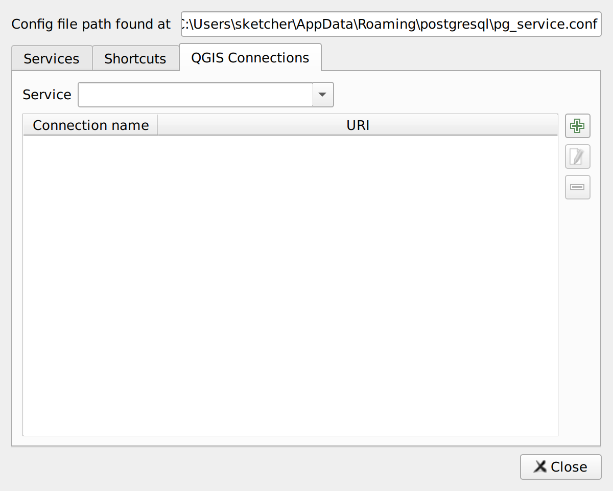

# QGIS Connection to a PG service

The **Connections** tab lets you create QGIS connections to a PostgreSQL database directly from the PG services you manage.

Once created, the connection will be available in the QGIS Browser as well as in the Data Source Manager, for you to add layers to the project.
