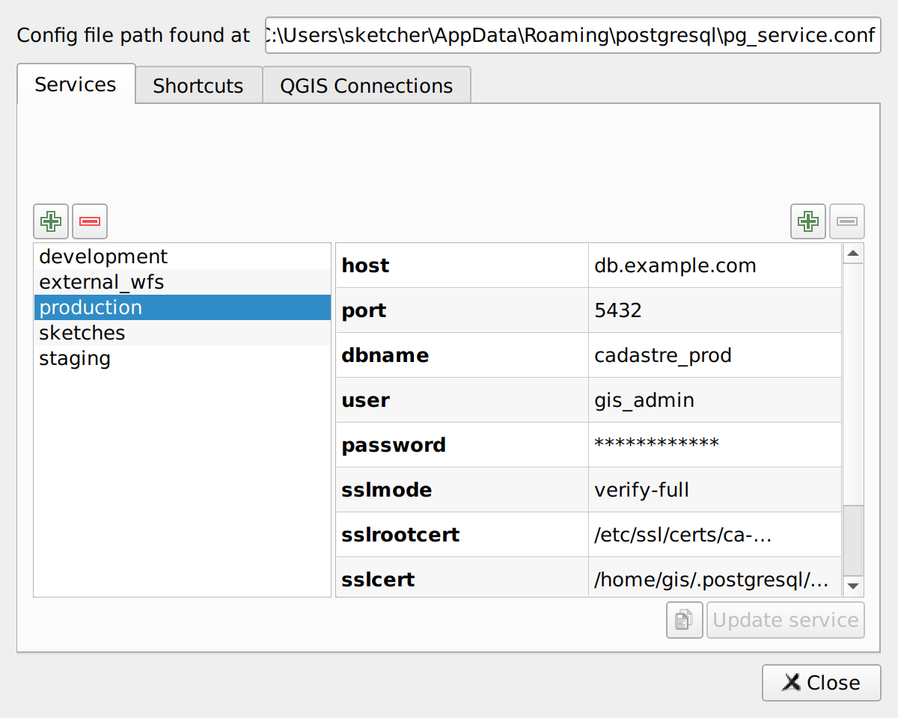
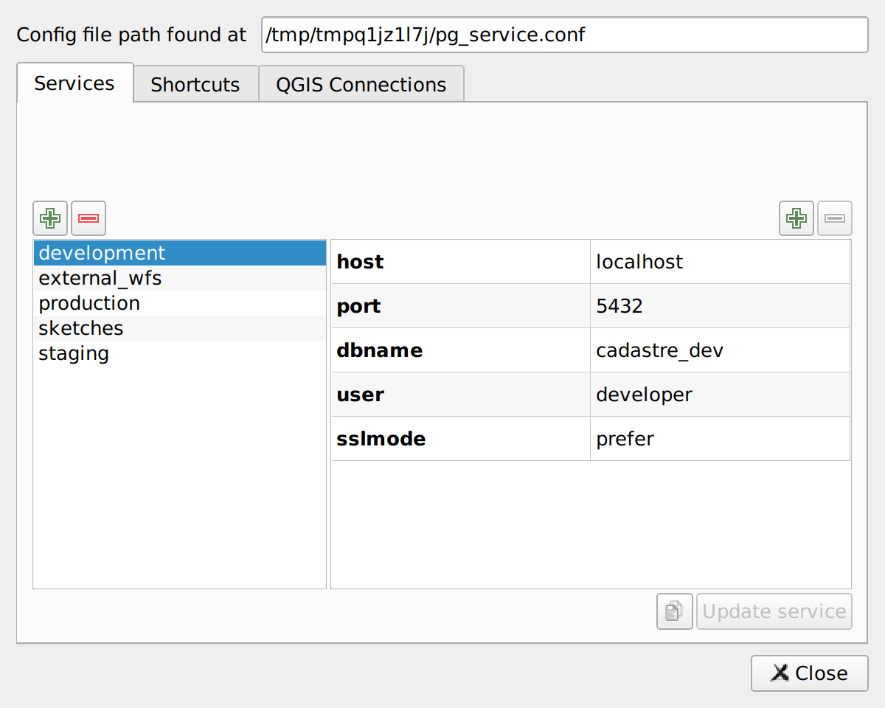

# Edit PG service entries

The **Services** tab lets you manage your `pg_service.conf` entries.

You can:

- **Add** a new service
- **Remove** one or multiple services
- **Rename** a service (right-click context menu)
- **Duplicate** a service (right-click context menu)
- **Edit settings** — add, remove, or modify key/value pairs for any service
- **Copy settings** to clipboard in `pg_service.conf` format

## Duplicate PG service entries

To duplicate a service, right-click on it and choose **Duplicate service...**. Enter a target service name: if it already exists, you can overwrite it; otherwise, a new service is created.

