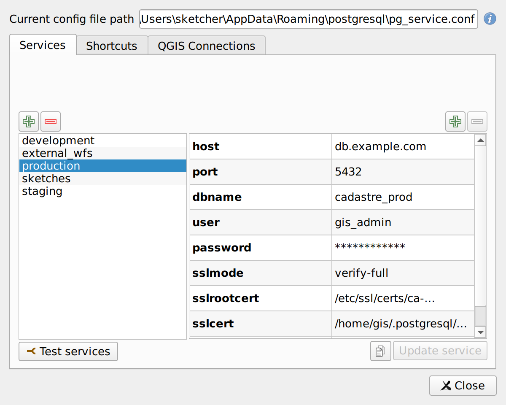
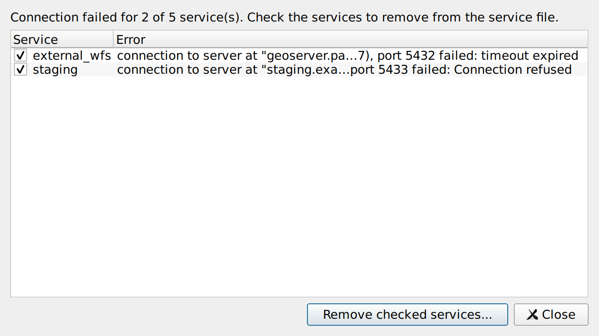
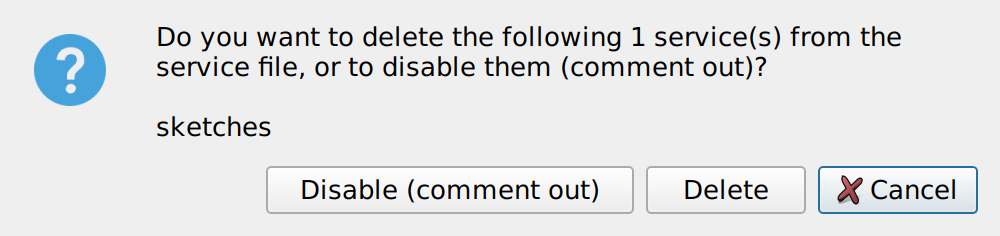
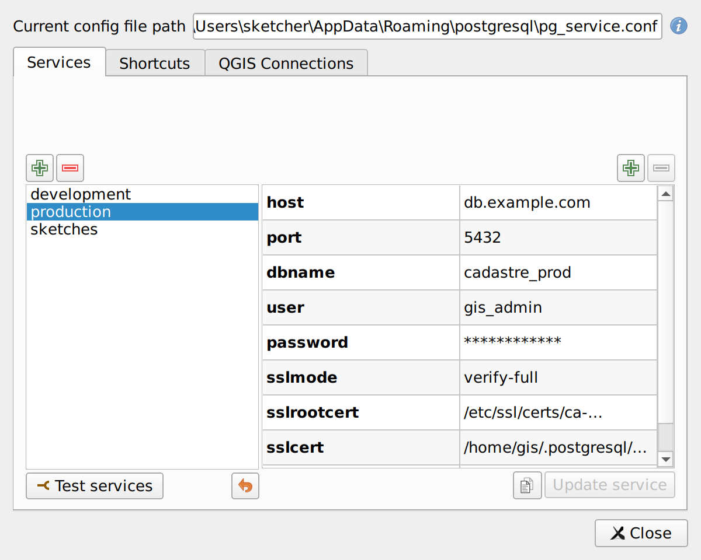
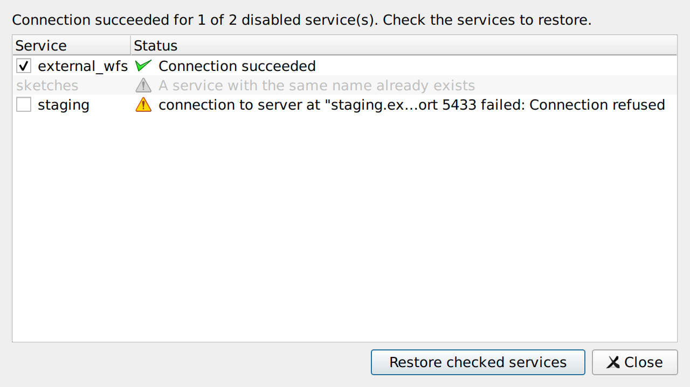
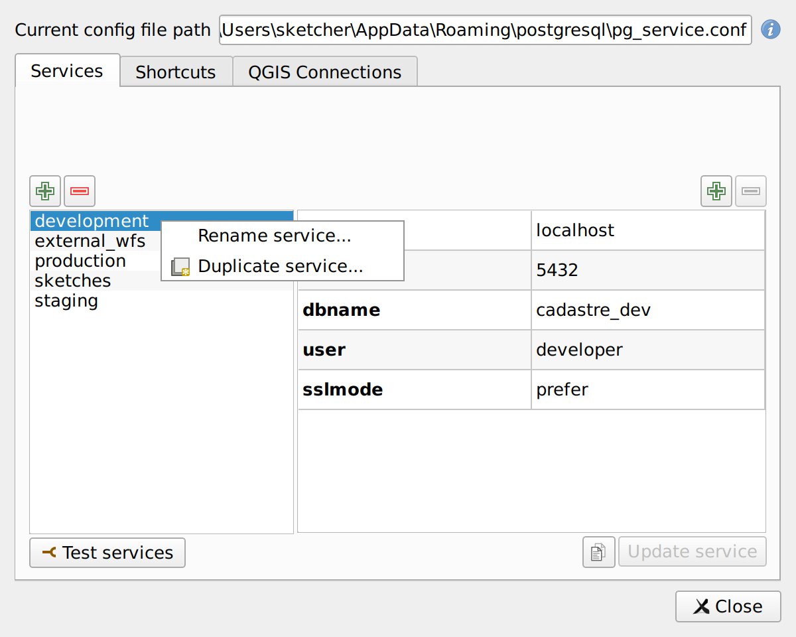

# Edit PG service entries

The **Services** tab lets you manage your `pg_service.conf` entries.

You can:

- **Add** a new service
- **Remove** one or multiple services, by deleting or disabling them (comment out)
- **Restore** disabled services
- **Rename** a service (right-click context menu)
- **Duplicate** a service (right-click context menu)
- **Edit settings** — add, remove, or modify key/value pairs for any service
- **Copy settings** to clipboard in `pg_service.conf` format
- **Test** the connection to all services and clean up the failing ones

## Test PG service entries

Click **Test services**, below the service list, to try connecting to every service. Services are tested in the background, several at a time, with a timeout of 10 seconds each. Closing the dialog cancels the test.

The services that could not be connected are listed with the error message (hover over it to see the full message). Check the ones you want to clean up and click **Remove checked services...**: you can then either **Delete** them or **Disable (comment out)** them, see [below](#disable-and-restore-pg-service-entries).

!!! note
    Testing services requires the `psycopg` or `psycopg2` Python package, which is shipped with most QGIS installations.

## Disable and restore PG service entries

When removing services, from the service list or from the test dialog, you can either **Delete** them or **Disable (comment out)** them: their lines are then commented out in the service file, so that they are not used anymore but can be restored later.

If some services are disabled, a restore button is shown next to **Test services**.

It lists the disabled services and tests them in the background: the ones that can be connected are checked, the others are flagged with the error message. A disabled service cannot be restored if a service with the same name already exists. Check the services you want to restore and click **Restore checked services**.

## Duplicate PG service entries

To duplicate a service, right-click on it and choose **Duplicate service...**. Enter a target service name: if it already exists, you can overwrite it; otherwise, a new service is created.

