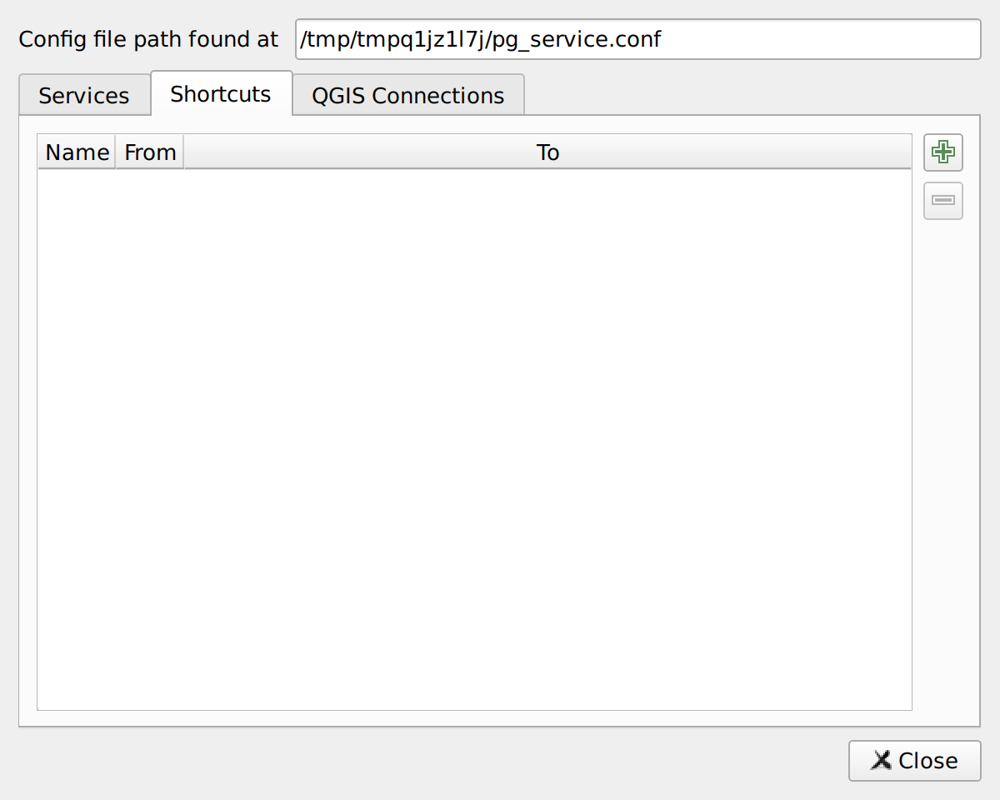

# Shortcuts

If you perform the same overwrite operation regularly (e.g., switching from one service definition to another while preserving the name), you can add **Shortcuts**. These give you a handy way to execute the same copy from the plugin toolbar button or from the **Database** menu.

